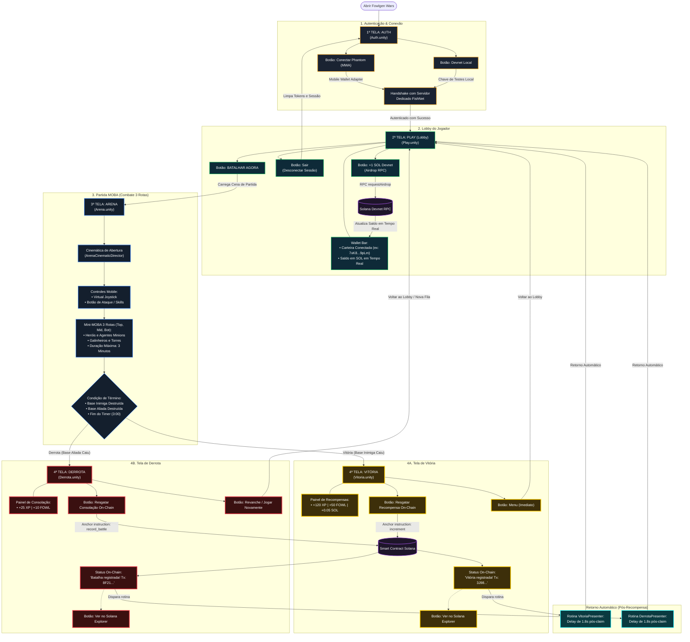

# Fluxo Oficial do Jogo: Fowlgen Wars (4 Telas)

Este documento descreve a arquitetura operacional, telas e jornada do jogador no **Fowlgen Wars**, abrangendo o fluxo de 4 telas oficiais com autenticação Web3 (Solana/Phantom), networking dedicado (FishNet), ciclo de partida MOBA e liquidação on-chain com retorno automático ao Lobby.

---

## 1. Visão Geral das 4 Telas Oficiais

```
[1ª Tela: AUTH] 
       │  • Login via Carteira Phantom (MWA) ou Devnet Local
       │  • Autenticação e handshake com o Servidor Dedicado FishNet
       ▼
[2ª Tela: PLAY] (Lobby pós-login)
       │  • Exibe carteira conectada e saldo em SOL em tempo real
       │  • Botão "+1 SOL Devnet" (Airdrop) e Botão "Sair" (Desconectar)
       │  • Botão "BATALHAR AGORA"
       ▼
[3ª Tela: ARENA] (Partida)
       │  • Combate MOBA 3 rotas (Heróis, Minions, Galinheiros)
       │  • Cinemática de introdução e Controles Mobile (Joystick + Ataque)
       │  • Destruição de base ou fim do tempo de 3 minutos
       ├── Vitória ────────► [4ª Tela: VITÓRIA] (Recompensa On-Chain, Solana Explorer, Retorno Automático)
       └── Derrota ────────► [4ª Tela: DERROTA] (Consolação On-Chain, Solana Explorer, Retorno Automático)
```

---

## 2. Diagrama de Fluxo Completo (Mermaid)



---

## 3. Detalhamento Técnico das Funcionalidades Implementadas

### [1ª Tela: AUTH] (Autenticação e Conexão)
* **Arquitetura Modular:** Gerenciado por `AuthPresenter.cs` pertencente ao módulo `FowlgenWars.Modules.Auth`.
* **Login Web3 MWA:** Integração com o protocolo **Mobile Wallet Adapter (MWA)** permitindo assinatura e login biométrico ou direto com o app Phantom Android/iOS.
* **Devnet Local:** Opção para testes em desenvolvimento simulando uma carteira Solana gerada localmente.
* **FishNet Dedicated Server Handshake:** Conexão de rede via `FishNetNetworkManager`, estabelecendo o handshake criptografado do player com o servidor autoritativo da partida.
* **Transição Direta:** Ao obter sucesso na validação de credenciais, o fluxo transita de forma direta e contínua para a tela `Play` (eliminando a antiga redundância do MainMenu).

---

### [2ª Tela: PLAY] (Lobby Pós-Login)
* **Status da Carteira em Tempo Real:** Exibe a chave pública abreviada (ex: `7xK8...9pLm`) e consulta ativa ao RPC da Solana para exibir o saldo atualizado em SOL.
* **Botão "+1 SOL Devnet" (Airdrop):**
  * Invoca `requestAirdrop` no cluster Devnet da Solana.
  * Inclui bloqueio temporário do botão durante a confirmação e atualização dinâmica do saldo na tela.
* **Botão "Sair" (Desconectar):**
  * Finaliza a sessão atual, revoga credenciais em cache e retorna o jogador para a tela inicial de `Auth`.
* **Botão "BATALHAR AGORA":**
  * Inicia o pareamento/matchmaking e carrega a cena de combate `Arena`.

---

### [3ª Tela: ARENA] (Partida MOBA 1v1)
* **Cinemática de Abertura:** Conduzida por `ArenaCinematicDirector.cs` para apresentação da arena antes do início do controle dos jogadores.
* **Controles Mobile:**
  * `Joystick.cs` para movimentação analógica com suporte a toque touch e gamepad.
  * `AttackButton.cs` para ataques básicos e acionamento de habilidades com cooldowns.
* **Dinâmica MOBA (3 Rotas):**
  * Spawn automatizado de minions por rota (`MinionAgent.cs`).
  * Galinheiros (torres de defesa e base central).
* **Condições de Vitória/Derrota:**
  * Destruição do galinheiro inimigo -> Vitória.
  * Destruição do galinheiro aliado -> Derrota.
  * Tempo limite de 3 minutos esgotado -> Vencedor calculado pelo dano acumulado nas bases.

---

### [4ª Tela: VITÓRIA] (Campeão)
* **Recompensas:** Exibição de XP (+120), Tokens do jogo (+50 FOWL) e fração de recompensa (+0.05 SOL).
* **Liquidação On-Chain:** O botão "Resgatar Recompensa On-Chain" envia instrução para o smart contract (Anchor) na rede Solana.
* **Solana Explorer:** Link direto dinâmico gerado com a transação confirmada (ex: `https://explorer.solana.com/tx/.../?cluster=devnet`).
* **Retorno Automático (Implementado):** Implementada a corrotina `ReturnToPlayDelayedRoutine(1.8f)` no `VitoriaPresenter.cs`, garantindo que após colher a recompensa, o jogador retorne automaticamente para a tela **Play (Lobby)** sem fricção.
* **Botão Menu:** Opção manual para retorno imediato ao Lobby.

---

### [4ª Tela: DERROTA] (Batalha Concluída)
* **Recompensa de Consolação:** Bonificação de participação (+25 XP, +10 FOWL).
* **Registro On-Chain:** Botão para registro da partida e resgate de consolação via Smart Contract.
* **Solana Explorer:** Hash de transação acessível para auditoria e histórico do jogador.
* **Retorno Automático (Implementado):** Mesma rotina de transição fluida `ReturnToPlayDelayedRoutine(1.8f)` no `DerrotaPresenter.cs`, retornando automaticamente para a tela **Play (Lobby)** após o claim.
* **Botão Revanche:** Atalho para reengajamento imediato.
