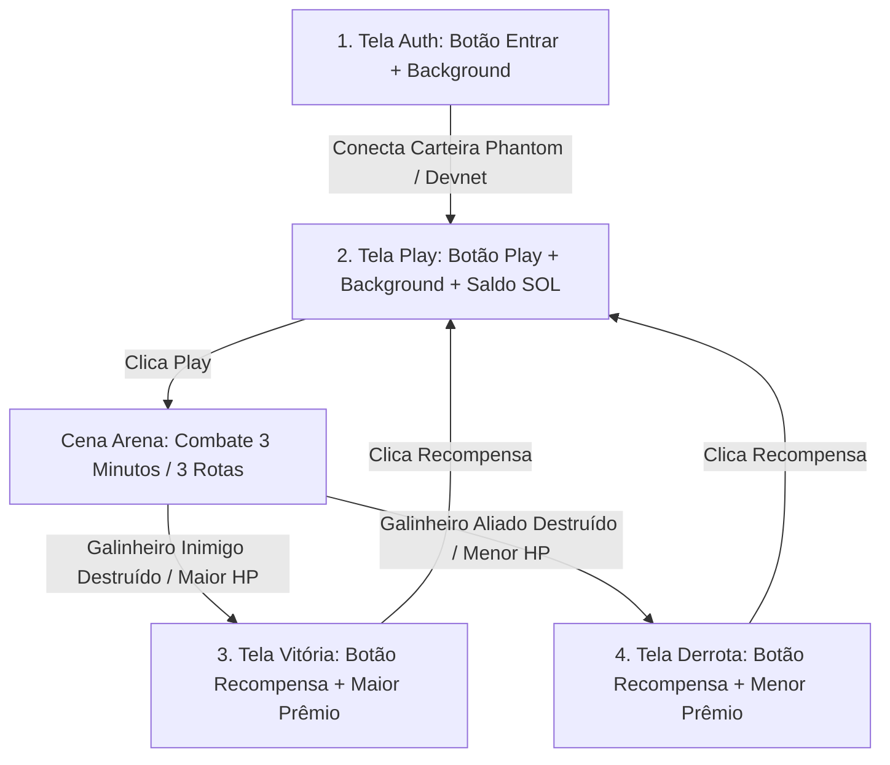

# Relatório de Desenvolvimento: Andamento das Etapas do MVP Unity (Fowlgen Wars)

**Data de Emissão:** 11 de Outubro de 2026  
**Projeto:** Fowlgen Wars (G5B Studios)  
**Documento de Referência:** `Fowlgen-Wars-Etapas-MVP-Unity.md`, `Plano_Arquitetura_Modular_DDD_Csproj.md` e `Claude.md`  
**Responsáveis:** Marcos (Líder Técnico / Dev Core Unity & Web3) e Equipe Técnica G5B  
**Meta Interna:** 10 de Outubro de 2026 (Homologação & Estresse de QA)  
**Prazo Oficial Colosseum Hackathon:** 12 de Outubro de 2026 às 23h59 PDT (13/10 às 03h59 BRT)  

---

## 1. Resumo Executivo e Arquitetura Modular (DDD + MVP)

O presente relatório consolida o status técnico do desenvolvimento do **MVP Unity do Fowlgen Wars**, integrando a evolução das **4 telas oficiais** (Auth, Play, Vitória e Derrota) e a nova arquitetura em **Módulos Independentes (DDD Bounded Contexts + Injeção de Dependências por Módulo)** com arquivos de projeto `.csproj` gerados via `.asmdef`.

A camada de infraestrutura local foi despoluída (remoção de IDLs duplicados, limpeza de cenas legadas e criação do pacote independente `MobileControls`), garantindo compilação limpa e desacoplamento para dispositivos móveis Android e Web3.

---

## 2. Matriz de Acompanhamento das Fases

| Fase | Título da Etapa | Status | Detalhamento & Evidências |
| :--- | :--- | :---: | :--- |
| **Fase 1** | **Interface, Setup Multiplataforma e Fundação Cinemática** | **Concluída / Limpa** | • Dependências configuradas (Input System, UI Toolkit, Solana Unity SDK, Cinemachine). • Cenas base consolidadas (`Auth`, `Play`, `Arena`, `Vitoria`, `Derrota`). Cenas órfãs (`Login.unity`, `SampleScene.unity`) e resíduos temporários removidos. • IDL Anchor canônico unificado em `Assets/Resources/fowlgen_wars_contract.json`. |
| **Fase 2** | **Terreno 3D e Câmera de Gameplay (MOBA)** | **Concluída** | • Cenário de 3 rotas (Top, Mid, Bot) modelado e integrado na cena de combate. • Estruturas dos Galinheiros Aliado e Inimigo (`StructureGalinheiro.cs`) com sistema de pontos de vida. • Torres de defesa e trilhas de Waypoints (`WaypointPath.cs`) mapeadas. • Câmera MOBA configurada com parâmetros isométricos táticos (`MobaCameraController.cs`). |
| **Fase 3** | **Controles e Compilação Unificada (Módulo DDD)** | **Concluída / Modularizada** | • Criação do módulo independente **`Assets/Modules/MobileControls/`** com `.asmdef` dedicado (`FowlgenWars.Modules.MobileControls.csproj`). • Contrato de domínio `IJoystickInput`, `VirtualJoystickView` e `MobileInputReader` com DI autônomo via `MobileControlsInstaller`. • Agente do Herói (`HeroAgent.cs`) e tropas (`MinionAgent.cs`) com cooldowns por rota. |
| **Fase 4** | **Sistema de Contas, UI das 4 Telas e Solana** | **Em Execução (Refinamento)** | • Especificação e padronização do fluxo completo das **4 Telas** (Auth, Play, Vitória e Derrota). • Conexão direta com a carteira **Phantom** via `WalletManager.cs` (Solana Mobile Wallet Adapter e Devnet). • Consulta e exibição em tempo real do saldo em SOL na tela Play. • Distribuição e exibição de recompensas pós-combate (Maior prêmio na Vitória / Menor na Derrota). |
| **Fase 5** | **Resolução de QA e Deploy Multiplataforma** | **Planejada** | • Validação final dos 4 testes de QA da Sprint 01. • Exportação de build de testes Android (`.apk`). • Exportação de build de publicação Google Play (`.aab`) assinada. • Exportação WebGL para incorporação no portal oficial. |

---

## 3. Especificação do Fluxo e Regras das 4 Telas

O ciclo de jogo do MVP do Fowlgen Wars é estruturado rigorosamente em **4 telas de interface**, garantindo navegação contínua, responsiva (landscape mobile) e sem bloqueios:

### 3.1. Tela `Auth`
- **Design & Layout:** Imagem de fundo temática estilizada cobrindo toda a área visível (`background-size: cover`), proporcionando imersão imediata.
- **Elemento Central:** Botão único centralizado com a inscrição **"Entrar"**.
- **Comportamento Web3:** 
  - Ao ser clicado, solicita conexão com a carteira **Phantom** utilizando o Solana Unity SDK (`WalletManager.Instance.ConnectWalletAdapter`).
  - Fallback local para carteira Devnet integrada para testes fluidos no Editor/Desktop.
- **Transição:** Após a confirmação da chave pública da carteira, a aplicação transiciona para a tela **Play**.

### 3.2. Tela `Play`
- **Design & Layout:** Imagem de fundo temática e painel de identificação do jogador.
- **Saldo da Carteira em Tempo Real:** Exibição clara e legível do saldo atual em SOL (ex.: `Saldo: 1.500 SOL`), atualizado via RPC na Solana Devnet através de `WalletManager.Instance.UpdateBalance()`.
- **Elemento Central:** Botão destacado e centralizado com a inscrição **"Play"**.
- **Transição:** Ao clicar em "Play", carrega a cena de batalha da **Arena**.

### 3.3. Cena da `Arena` (Loop de Combate)
- O combate ocorre com herói e tropas em 3 rotas (Top, Mid, Bot), durando até 3 minutos ou até a queda de um dos Galinheiros.
- **Gatilho de Vitória:** Destruição do Galinheiro Inimigo ou maior HP aliado no final do tempo $\rightarrow$ Carrega a cena `Vitoria`.
- **Gatilho de Derrota:** Destruição do Galinheiro Aliado ou menor HP aliado no final do tempo $\rightarrow$ Carrega a cena `Derrota`.

### 3.4. Tela `Vitória`
- **Design & Layout:** Imagem de fundo temática triunfal.
- **Elemento Central:** Botão centralizado com a inscrição **"Recompensa"**.
- **Lógica de Premiação:** 
  - Concede a **Maior Recompensa** (ex.: `+100 XP / +50 FOWL Tokens / 0.05 SOL`).
  - Ao clicar no botão, exibe o popup com os itens conquistados e redireciona automaticamente o jogador de volta para a tela **Play** com o saldo e progressão atualizados.

### 3.5. Tela `Derrota`
- **Design & Layout:** Imagem de fundo temática de combate.
- **Elemento Central:** Botão centralizado com a inscrição **"Recompensa"**.
- **Lógica de Premiação:** 
  - Concede a **Menor Recompensa** de consolação por participação (ex.: `+20 XP / +5 FOWL Tokens`).
  - Ao clicar no botão, apresenta o feedback do valor recebido e redireciona o jogador de volta para a tela **Play**.

---

## 4. Evolução Modular dos .csproj

Com a introdução da arquitetura DDD em módulos, o projeto passa a ter projetos C# dedicados:
1. `FowlgenWars.Modules.MobileControls.csproj` (Controles táteis e joystick universal).
2. `FowlgenWars.Modules.Solana.csproj` (SDK Web3 e contratos Anchor).
3. `FowlgenWars.Modules.Auth.csproj` (Autenticação híbrida FishNet/WebApi e carteira).
4. `FowlgenWars.Modules.Gameplay.csproj` (Loop de combate, herói, tropas e galinheiro).

---
*Relatório atualizado e homologado conforme diretrizes do Claude.md.*
