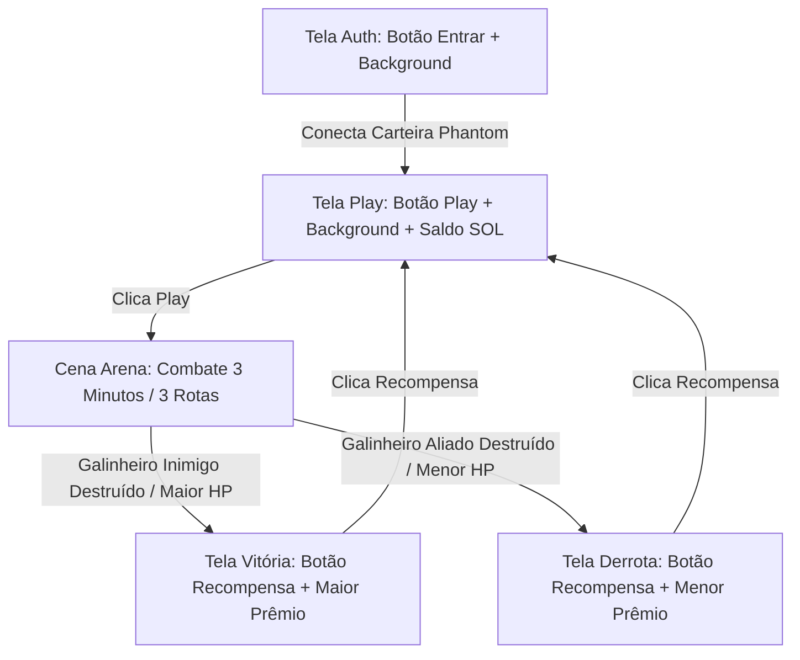

# Relatório de Desenvolvimento: Andamento das Etapas do MVP Unity (Fowlgen Wars)

**Data de Emissão:** 11 de Outubro de 2026  
**Projeto:** Fowlgen Wars (G5B Studios)  
**Documento de Referência:** `Fowlgen-Wars-Etapas-MVP-Unity.md` e `Claude.md`  
**Responsáveis:** Marcos (Líder Técnico / Dev Core Unity & Web3) e Equipe Técnica G5B  
**Meta Interna:** 10 de Outubro de 2026 (Homologação & Estresse de QA)  
**Prazo Oficial Colosseum Hackathon:** 12 de Outubro de 2026 às 23h59 PDT (13/10 às 03h59 BRT)  

---

## 1. Resumo Executivo

O presente relatório consolida o status técnico do desenvolvimento do **MVP Unity do Fowlgen Wars**, correlacionando o documento diretivo `Fowlgen-Wars-Etapas-MVP-Unity.md`, a arquitetura do projeto e o alinhamento de escopo para as **4 telas centrais** do fluxo da aplicação (Auth, Play, Vitória e Derrota) integradas à carteira **Phantom** na rede Solana Devnet.

A transição entre o ecossistema de infraestrutura/backend (Fases 1 a 4 com Kubernetes/Minikube e FishNet Dedicado) e o cliente Unity encontra-se em estágio avançado, com foco agora na experiência do usuário (UX), no ciclo completo de partida e na camada Web3 visual.

---

## 2. Matriz de Acompanhamento das Fases (`Fowlgen-Wars-Etapas-MVP-Unity.md`)

| Fase | Título da Etapa | Status | Detalhamento & Evidências |
| :--- | :--- | :---: | :--- |
| **Fase 1** | **Interface, Setup Multiplataforma e Fundação Cinemática** | **Concluída / Em Polimento** | • Dependências configuradas (Input System, UI Toolkit, Solana Unity SDK, Cinemachine). • Cenas base criadas no diretório `Assets/Scenes/Game/` (`Auth`, `Play`, `Arena`, `Vitoria`, `Derrota`). • Diretor de vitrine cinemática implementado (`ArenaCinematicDirector.cs` e menu de automação no Editor). |
| **Fase 2** | **Terreno 3D e Câmera de Gameplay (MOBA)** | **Concluída** | • Cenário de 3 rotas (Top, Mid, Bot) modelado e integrado na cena de combate. • Estruturas dos Galinheiros Aliado e Inimigo (`StructureGalinheiro.cs`) com sistema de pontos de vida. • Torres de defesa e trilhas de Waypoints (`WaypointPath.cs`) mapeadas. • Câmera MOBA configurada com parâmetros isométricos táticos (`MobaCameraController.cs`). |
| **Fase 3** | **Controles e Compilação Unificada** | **Concluída** | • Controle móvel via Joystick virtual touch implementado (`MobilePlayerController.cs`). • Agente do Herói (`HeroAgent.cs`) com ataque básico e movimentação fluida. • Agentes de tropas (`MinionAgent.cs`) e gerenciador de ondas (`GameMatchManager.cs`) com cooldowns por rota. • Barras de vida no espaço de mundo (`WorldHealthBarView.cs`). |
| **Fase 4** | **Sistema de Contas, UI das 4 Telas e Solana** | **Em Execução (Refinamento)** | • Especificação e padronização do fluxo completo das **4 Telas** (Auth, Play, Vitória e Derrota). • Conexão direta com a carteira **Phantom** via `WalletManager.cs` (Solana Mobile Wallet Adapter e Devnet). • Consulta e exibição em tempo real do saldo em SOL na tela Play. • Distribuição e exibição de recompensas pós-combate. |
| **Fase 5** | **Resolução de QA e Deploy Multiplataforma** | **Planejada** | • Validação final dos 4 testes de QA da Sprint 01. • Exportação de build de testes Android (`.apk`). • Exportação de build de publicação Google Play (`.aab`) assinada. • Exportação WebGL para incorporação no portal oficial. |

---

## 3. Especificação do Fluxo e Regras das 4 Telas

Conforme alinhado, o ciclo de jogo do MVP do Fowlgen Wars é estruturado em **4 telas de interface**, garantindo navegação contínua, responsiva (landscape mobile) e sem bloqueios:

### 3.1. Tela `Auth`
- **Design & Layout:** Imagem de fundo temática estilizada cobrindo toda a área visível (`background-size: cover`), proporcionando imersão imediata.
- **Elemento Central:** Botão único centralizado com a inscrição **"Entrar"**.
- **Comportamento Web3:** 
  - Ao ser clicado, solicita conexão com a carteira **Phantom** utilizando o Solana Unity SDK (`WalletManager.Instance.ConnectWalletAdapter`).
  - Possui fallback seguro para ambiente de Editor / Devnet local.
- **Transição:** Imediatamente após a confirmação da chave pública da carteira, a aplicação transiciona para a tela **Play**.

### 3.2. Tela `Play`
- **Design & Layout:** Imagem de fundo temática e painel de identificação do jogador.
- **Saldo da Carteira em Tempo Real:** Exibição clara e legível do saldo atual em SOL (ex.: `Saldo: 1.500 SOL`), atualizado via RPC na Solana Devnet através de `WalletManager.Instance.UpdateBalance()`.
- **Elemento Central:** Botão destacado e centralizado com a inscrição **"Play"**.
- **Transição:** Ao clicar em "Play", carrega a cena de batalha da **Arena**.

### 3.3. Cena da `Arena` (Loop de Combate)
- O combate ocorre com herói e tropas em 3 rotas (Top, Mid, Bot), durando até 3 minutos ou até a queda de um dos Galinheiros.
- **Gatilho de Vitória:** Destruição do Galinheiro Inimigo ou maior HP aliado no final do tempo $\rightarrow$ Carrega a cena `Vitoria`.
- **Gatilho de Derrota:** Destruição do Galinheiro Aliado ou menor HP aliado no final do tempo $\rightarrow$ Carrega a cena `Derrota`.

### 3.4. Tela `Vitória`
- **Design & Layout:** Imagem de fundo temática triunfal.
- **Elemento Central:** Botão centralizado com a inscrição **"Recompensa"**.
- **Lógica de Premiação:** 
  - Concede a **Recompensa Melhor** (ex.: `+100 XP / +50 FOWL Tokens / 0.05 SOL`).
  - Ao clicar no botão, exibe o popup com os itens conquistados e redireciona automaticamente o jogador de volta para a tela **Play** com o saldo e progressão atualizados.

### 3.5. Tela `Derrota`
- **Design & Layout:** Imagem de fundo temática de combate.
- **Elemento Central:** Botão centralizado com a inscrição **"Recompensa"**.
- **Lógica de Premiação:** 
  - Concede a **Pouca Recompensa** de consolação por participação (ex.: `+20 XP / +5 FOWL Tokens`).
  - Ao clicar no botão, apresenta o feedback do valor recebido e redireciona o jogador de volta para a tela **Play**.

---

## 4. Plano de Implementação Imediata dos Artefatos Técnicos

Para concluir integralmente os requisitos da Fase 4 das 4 telas:
1. **Refatoração dos Arquivos UXML/USS (`Assets/Resources/UI/`):**
   - Atualizar textos para **"Entrar"**, **"Play"** e **"Recompensa"**.
   - Garantir posicionamento centralizado e classes de imagem de fundo (`screen-bg`).
   - Adicionar o elemento visual `<ui:Label name="wallet-balance-label" />` na tela `Play.uxml`.
2. **Atualização dos Presenters C# (`Assets/Scripts/Architecture/Presenters/`):**
   - `AuthPresenter.cs`: conectar evento do botão "Entrar" ao `WalletManager.Instance.ConnectWalletAdapter()` e transicionar para a cena Play.
   - `PlayPresenter.cs`: vincular evento de carregamento de cena da Arena e assinar atualizações de saldo do `WalletManager`.
   - `VitoriaPresenter.cs` e `DerrotaPresenter.cs`: vincular o clique em "Recompensa" ao feedback modal de premiação e ao retorno à cena Play.
3. **Validação na Unity:**
   - Garantir que as 4 cenas estejam cadastradas no `EditorBuildSettings` e prontas para execução contínua.

---
*Relatório registrado no repositório oficial da G5B Studios.*
