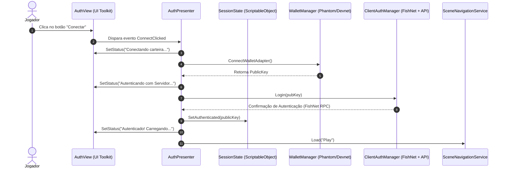

# Relatório de Arquitetura: MVP (Model-View-Presenter) + ScriptableObjects no Fowlgen Wars

> **Projeto:** Fowlgen Wars (Unity + FishNet + Solana + .NET 9 WebApi)  
> **Data:** 11 de Outubro de 2026  
> **Padrão Adotado:** Model-View-Presenter (Passive View) com ScriptableObjects Reativos e de Configuração  

---

## 1. O que é o Padrão MVP + ScriptableObjects?

O padrão **MVP (Model-View-Presenter)** separa a responsabilidade da interface visual, dos dados e da lógica de apresentação em três papéis bem definidos:

* **Model (Dados & Estado):** Armazena os dados, regras de dados e estado da aplicação. No Unity, o uso de **ScriptableObjects** como Models permite que esses dados vivam fora da hierarquia da cena, sobrevivam a trocas de cena, sejam configuráveis no Inspector e funcionem como canais globais desacoplados.
* **View (Camada Visual):** Responsável estritamente pelo que é exibido e pela captura de inputs do usuário (*Passive View*). Não possui regras de negócio, chamadas de rede ou integrações diretas com blockchain.
* **Presenter (Intermediário / Maestro):** O mediador. Ele escuta os eventos da View, invoca regras de negócio/serviços e consome ou atualiza os dados do Model. Quando os dados mudam, ele notifica a View para se atualizar.

---

## 2. Como Estamos Utilizando no Fowlgen Wars

No **Fowlgen Wars**, a arquitetura está dividida em diretórios modulares em `Assets/Scripts/Architecture/`:

```
Assets/Scripts/Architecture/
├── Contracts/       # Interfaces desacopladas (IScreenView, INavigationService, IDamageable)
├── Models/          # ScriptableObjects de configuração e estado em tempo real
├── Presenters/      # Orquestradores de tela e fluxo (Auth, Play, Match, Arena, etc.)
├── Services/        # Serviços utilitários independentes (ex: SceneNavigationService)
└── Views/           # Implementações visuais baseadas em UI Toolkit (UXML/USS)
```

---

## 3. Divisão dos Componentes na Prática

### 3.1. Model (ScriptableObjects)
Utilizamos ScriptableObjects para dois propósitos centrais:

1. **Estado Compartilhado e Reativo (Runtime State):**
   * **`SessionState.cs`:** Armazena o endereço da carteira conectada (`WalletAddress`) e se o jogador está autenticado (`Authenticated`). Permite que o `AuthPresenter` grave os dados após a autenticação e o `PlayPresenter` leia esses mesmos dados na cena seguinte sem depender de `DontDestroyOnLoad` espalhado pela cena.
   * **`MatchRuntimeStateSO.cs`:** Atua como um barramento reativo de eventos da partida (`OnTimerUpdated`, `OnPlayerHpUpdated`, `OnEnemyHpUpdated`, `OnStateChanged`). A simulação de gameplay alimenta esse objeto, e os Presenters escutam os eventos sem acoplamento direto com Managers.

2. **Configurações Imutáveis / Design de Jogo:**
   * **`NavigationConfig.cs`:** Centraliza os nomes das cenas (`Auth`, `Play`, `Arena`), evitando *magic strings* de `SceneManager.LoadScene()`.
   * **`MatchConfigSO.cs`:** Parâmetros de balanceamento da partida (tempo de rodada, vidas dos galinheiros, etc.).
   * **`MinionDataSO.cs`:** Atributos estáticos das tropas (HP, Dano, Velocidade, Rota, Custos).

---

### 3.2. View (UI Toolkit Passivo)
Todas as telas herdam de **`ScreenViewBase.cs`**, que padroniza o ciclo de vida do UI Document (`UIDocument`), estilos USS e a árvore UXML:

* **`AuthView.cs`:** Localiza o botão `#connect-button` e o rótulo `#login-status`. Dispara o evento C# `ConnectClicked` quando o jogador clica no botão e fornece o método `SetStatus(string message)`. Não sabe se a carteira é Phantom, Solana ou Mock.
* **`PlayView.cs`:** Expõe o botão de iniciar partida (`PlayClicked`) e a exibição da chave pública truncada do jogador.
* **`GameplayHUDView.cs`:** Exibe a barra de vida dos galinheiros, botões de invocação de tropas (Top, Mid, Bot) com máscara de recarga (cooldown), joystick virtual e botão de ataque.
* **`VitoriaView.cs` / `DerrotaView.cs`:** Telas de encerramento de partida exibindo recompensas e botão de retorno ao lobby.

---

### 3.3. Presenter (Lógica e Coordenação)
Os Presenters são MonoBehaviours vinculados aos GameObjects da cena que amarram as Views aos Models e aos Sistemas de Backend:

* **`AuthPresenter.cs`:**
  * Escuta `view.ConnectClicked`.
  * Chama `WalletManager.Instance.ConnectWalletAdapter()` (Solana / Phantom) com fallback local.
  * Aciona `ClientAuthManager.Login()` (FishNet RPC + WebApi .NET 9).
  * Ao autenticar com sucesso, atualiza o Model `SessionState.SetAuthenticated(pubKey)`.
  * Comanda a View: `view.SetStatus("Autenticado...")`.
  * Chama `SceneNavigationService.Load("Play")`.
* **`MatchPresenter.cs`:**
  * Assina eventos da `GameplayHUDView` (`OnSpawnRequested`, `OnAttackRequested`).
  * Assina eventos do `MatchRuntimeStateSO` (`OnTimerUpdated`, `OnPlayerHpUpdated`).
  * Atualiza a HUD continuamente com progresso dos tempos de recarga de tropas via `hudView.SetCooldownVisual()`.
* **`PlayPresenter.cs`:**
  * Lê o `SessionState` para exibir a carteira atual.
  * Responde ao `view.PlayClicked` redirecionando para a cena `Arena`.

---

## 4. Fluxo Completo: Exemplo de Autenticação



---

## 5. Vantagens Reais Observadas no Projeto

1. **Separação UI x Rede/Blockchain:** A interface gráfica construída no UI Toolkit não tem uma única linha de código ligada a RPC do FishNet ou transações Solana. Se trocarmos a biblioteca de UI ou o SDK de carteira, apenas uma camada é alterada.
2. **Dados Persistentes Sem Singletons Frágeis:** `SessionState` e `MatchRuntimeStateSO` eliminam a necessidade de *Singletons estáticos* acumulando lixo na memória entre cenas.
3. **Desenvolvimento em Paralelo:** Artistas e designers de UI podem alterar o UXML e USS no UI Builder do Unity sem quebrar scripts de lógica de jogo.
4. **Testabilidade e Manutenibilidade:** Com o uso de interfaces em `Contracts/`, os Presenters podem ser facilmente testados com mocks de Views e de Serviços.
