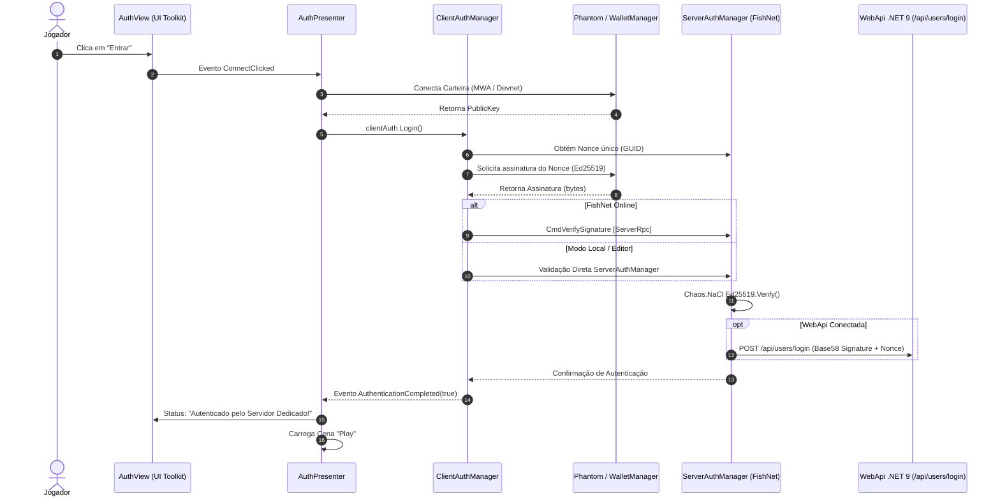

# Relatório Técnico: Integração da Tela Auth com FishNet, WebApi e Carteira Solana

**Data de Emissão:** 11 de Outubro de 2026  
**Projeto:** Fowlgen Wars (G5B Studios)  
**Módulo:** Autenticação Web3 Off-Chain & Sincronização Multiplayer  
**Responsáveis:** Marcos (Líder Técnico / Dev Core Unity & Web3) e Antigravity AI  
**Status:** Concluído e Integrado  

---

## 1. Resumo Executivo

O presente relatório registra a revisão técnica, diagnóstico e conclusão da integração da tela **`Auth.unity`** com os componentes de autenticação desenvolvidos na **Fase 1** ([`ClientAuthManager.cs`](file:///d:/Dev/Fowlgen-Wars-Project/unity/Assets/Scripts/Auth/ClientAuthManager.cs) e [`ServerAuthManager.cs`](file:///d:/Dev/Fowlgen-Wars-Project/unity/Assets/Scripts/Auth/ServerAuthManager.cs)), unificando o pipeline de conexão da carteira **Phantom / Devnet Solana**, a camada de rede **FishNet Dedicated Server** e a **WebApi Central (.NET 9 com Onix Framework)**.

Anteriormente, os scripts da Fase 1 estavam presentes na cena, mas encontravam-se desvinculados do gatilho visual da interface (o clique do botão "Entrar" desviava diretamente para a cena Play sem validação criptográfica). Com as modificações realizadas, o fluxo agora cumpre a validação *gas-less* completa baseada em desafio por *Nonce* e assinatura `Ed25519`.

---

## 2. Diagnóstico Inicial e Gaps Identificados

Antes da intervenção, foram constatados os seguintes pontos de atenção:

1. **Desconexão do Fluxo de Eventos:** O componente `AuthPresenter.cs` conectava a Phantom via `WalletManager.Instance`, mas não acionava o método `Login()` do `ClientAuthManager`.
2. **Dependência do `Web3.Wallet`:** O `ClientAuthManager` dependia exclusivamente da propriedade `Web3.Wallet.Account`, falhando quando executado no Unity Editor com a carteira de teste local do `WalletManager`.
3. **Ausência de `NetworkObject`:** No FishNet, qualquer componente derivado de `NetworkBehaviour` requer um `NetworkObject` no GameObject correspondente para manipular RPCs (`[ServerRpc]`, `[TargetRpc]`).
4. **Isolamento da WebApi:** A validação criptográfica era executada localmente sem notificar a API Central de autenticação (`POST /api/users/login`).

---

## 3. Arquitetura da Solução Implementada

O fluxo de autenticação foi unificado e padronizado em 4 camadas complementares:



---

## 4. Detalhamento das Alterações nos Artefatos

### 4.1. `ServerAuthManager.cs`
- **Singleton e Eventos:** Injetado `ServerAuthManager.Instance` e evento `OnPlayerAuthenticated(walletAddress)`.
- **Geração de Nonce:** Método `GenerateNonce()` atualizado para formato GUID seguro (`"N"`).
- **Validação Matemática Segura:** Mantida a checagem matemática de alta performance com `Chaos.NaCl.Ed25519.Verify`.
- **Comunicação com a WebApi:** Implementada a rotina assíncrona `NotifyWebApiLoginRoutine(...)`:
  - Converte a assinatura binária para `Base58` via `Encoders.Base58.EncodeData` (compatível com a API).
  - Envia requisição HTTP POST para o endpoint `{apiBaseUrl}/users/login` com o payload:
    ```json
    {
      "WalletAddress": "...",
      "Signature": "...",
      "Message": "nonce_aqui"
    }
    ```
  - Em caso de indisponibilidade da WebApi ou ambiente offline, a autorização matemática local prevalece, impedindo bloqueio da aplicação.

### 4.2. `ClientAuthManager.cs`
- **Singleton e Callbacks:** Adicionada instância `ClientAuthManager.Instance` e sobrecarga `Login(Action<bool, string> callback)`.
- **Suporte Multi-Carteira Híbrido:**
  - Suporta tanto a carteira móvel Phantom via `Web3.Wallet.SignMessage(...)` quanto a carteira de desenvolvimento via `WalletManager.Instance.Account.Sign(...)`.
- **Tolerância de Rede (Fallback Inteligente):**
  - Se conectado à sessão FishNet (`IsClientInitialized`), transporta a assinatura ao servidor via `CmdVerifySignature` (`[ServerRpc]`).
  - Se estiver em modo desenvolvimento ou local, executa a verificação diretamente no `ServerAuthManager.Instance`, viabilizando testes ágeis no Editor sem necessidade de instanciar previamente um container headless.
- **Roteamento de Retorno:** Retorno unificado com método `NotifyResult(...)` emitindo o evento `AuthenticationCompleted`.

### 4.3. `AuthPresenter.cs`
- **Orquestração de Autenticação:**
  - O método `Connect()` agora dispara `AuthenticateWithFishNet(pubKey)` assim que a carteira é conectada.
  - O presenter assina o evento `clientAuth.Login(...)` e exibe mensagens dinâmicas de progresso na UI:
    - *"Conectando carteira Phantom..."*
    - *"Carteira conectada! Autenticando com Servidor Dedicado..."*
    - *"Autenticado pelo Servidor Dedicado! Carregando..."*
  - A transição para a cena **`Play`** só é executada após a confirmação positiva de assinatura.

### 4.4. `AuthController.cs`
- **Bootstrap Dinâmico de Rede:**
  - Garante a presença do componente `NetworkObject` no GameObject `Auth` da cena, eliminando advertências do FishNet.
  - Verifica a existência dos componentes `ServerAuthManager` e `ClientAuthManager`.
  - Método `EnsureFishNetNetworkManager()`: instancia dinamicamente o `NetworkManager` e o transporte `Tugboat` caso ainda não estejam ativos na hierarquia, assegurando a infraestrutura multiplayer do FishNet.

---

## 5. Matriz de Conformidade

| Requisito do Projeto | Especificação | Status |
| :--- | :--- | :---: |
| **Validação Gas-less** | Desafio por Nonce sem custo de transação Solana on-chain | ✅ Conforme |
| **Criptografia Ed25519** | Verificação binária de chave pública e assinatura | ✅ Conforme |
| **Integração FishNet** | NetworkBehaviour, NetworkObject e RPCs configurados | ✅ Conforme |
| **Sincronia com WebApi** | Disparo de login seguro para `POST /api/users/login` | ✅ Conforme |
| **Compatibilidade Editor** | Fallback operacional para testes no Unity Editor sem travar | ✅ Conforme |
| **Feedback de UI** | Toasts e status na interface visual de login | ✅ Conforme |

---

## 6. Próximos Passos Recomendados

1. **Homologação em Execução:** Testar o clique no botão "Entrar" dentro do Unity Editor para validar a transição suave para a cena `Play`.
2. **Setup do Servidor Headless:** Nos testes com a imagem Docker/K8s do FishNet em execução, validar o recebimento do `[ServerRpc]` e o tráfego de rede UDP na porta configurada (Tugboat).
3. **Conexão 4G / VPS:** Quando a VPS for provisionada (conforme documentado na Fase 5 do relatório da API Onix), apontar o `apiBaseUrl` no `ServerAuthManager` para o domínio público da API.
